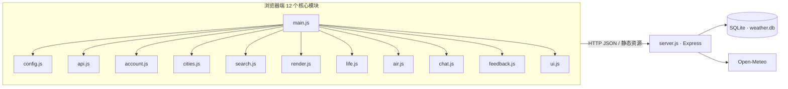

# Weather · 天气预报系统

这是一个不依赖前端框架的天气预报毕业设计项目：浏览器端负责城市搜索、天气展示、生活指数和反馈，Node.js 服务端负责 API、JWT 登录、管理员后台和 SQLite 持久化。天气与空气质量数据来自无需密钥的 Open-Meteo 接口。

## 技术栈

- 前端：原生 HTML/CSS/ES modules、Three.js（本地 vendor）
- 后端：Node.js 20+、Express 4、Helmet、CORS、express-rate-limit
- 数据：SQLite + better-sqlite3，WAL 模式
- 质量与测试：Vitest、Supertest、ESLint、Prettier、GitHub Actions

## 架构



`atmosphere.js`、`icons.js`、`visuals.js` 是 Three.js、图标和图表的支持模块；它们通过 `main.js` 装配，不改变上述 API 与数据流。

## 本地启动

1. 安装 Node.js 20 或更高版本。
2. 安装依赖：`npm ci`。
3. 先按 `.env.example` 建立 `.env`，设置至少 32 字符的 `JWT_SECRET`，并用 `node scripts/hash-password.js` 生成 `ADMIN_PASSWORD_HASH`。
4. 启动：`npm start`，默认地址为 <http://localhost:3001>。
5. 浏览器打开根地址；普通用户可在「我的」页面注册。后台地址为 `/admin`。

测试会自动创建独立临时数据库，不会使用生产库 `E:\weather\data\db`。

## 环境变量

| 变量                  | 必填 | 说明                                  |
| --------------------- | ---- | ------------------------------------- |
| `PORT`                | 否   | HTTP 端口，默认 `3001`                |
| `JWT_SECRET`          | 是   | JWT 签名密钥，至少 32 字符            |
| `ADMIN_USER`          | 是   | 后台用户名                            |
| `ADMIN_PASSWORD_HASH` | 是   | bcrypt 哈希，不要填写明文             |
| `DB_DIR`              | 否   | SQLite 目录；生产环境建议指向持久化卷 |
| `NODE_ENV`            | 否   | `production` 时启用生产安全策略       |

## 演示账号

- 普通用户：启动后在页面注册，例如 `demo_user` / `demo123`。
- 管理员：使用 `.env` 中的 `ADMIN_USER` 和对应 bcrypt 密码；项目不把管理员明文密码提交到仓库。

## 目录结构

```text
server.js                 Express API、JWT、SQLite 和管理员后台
frontend/                 HTML、CSS、12 个核心模块及支持模块
tests/                    Vitest + Supertest API 回归测试
scripts/                  数据库备份、证据静态检查等运维脚本
docs/api.md               逐路由 API 合约
docs/audit.json           npm audit 留档
evidence/                 各任务可复算证据
.github/workflows/ci.yml  CI：安装、lint、测试和守卫
```

## 运维命令

```bash
npm run backup:db       # VACUUM INTO 快照，保留最近 10 份
npm run check:versions  # 校验静态资源内容哈希版本
npm run check:evidence  # 本地启动 Edge 逐个跑证据脚本
```

CI 使用 `npm run check:evidence -- --static-only`：会执行证据脚本的静态版本串检查，但明确豁免需要本机 Edge 无头浏览器的动态截图/交互脚本。动态证据仍可在装有 Edge 的开发机上运行上面的完整命令；CI 没有把该守卫删除，而是记录了可复现的静态覆盖范围。

## 质量检查和测试隔离

`npm run lint` 使用 ESLint 做务实的语法与未定义变量检查，`npm run format:check` 检查新增文档和测试的 Prettier 格式，`npm test` 启动真实 `server.js` 子进程并覆盖注册、登录、JWT 过期/篡改/缺失、收藏、历史、管理员鉴权、XSS/密码字段和越界经纬度回归。每次测试使用 `os.tmpdir()` 的直接子目录作为 `DB_DIR`，结束时断言目录边界并清理；测试前后还会比较 `E:\weather\data\db\weather.db` 的 mtime、大小和各表行数。

## npm audit 结论

完整机器可读报告在 [`docs/audit.json`](docs/audit.json)。已通过不带 `--force` 的 `npm audit fix` 将 `express` 4.22.2→4.22.3、`body-parser` 1.20.5→1.20.8、`qs` 6.15.2→6.16.0，`npm audit` 显示 moderate/high/critical 均为 0（0 漏洞）；应用仍只启用固定 32 KB 的 JSON body parser、没有启用 URL-encoded 解析器，并已实测查询串解析边界。

API 字段、鉴权要求和错误码以仓库内 [`docs/api.md`](docs/api.md) 为准；服务启动 banner 也明确引用该文档。
